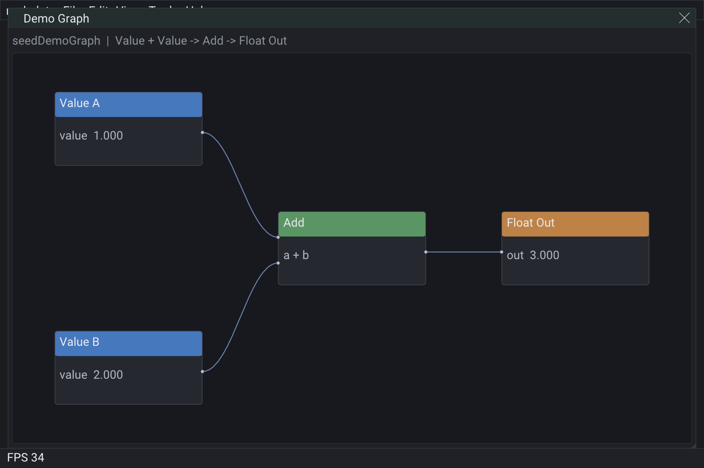

# nodedata



Seed a demo graph and live-eval Float Out.

Layout follows rigImGui chrome rules: `SetNextWindow*` before Begin, style padding /
frame metrics, `uiPx` / `uiHitSize`, and `GetColorU32` theme colors — no magic host
insets.

```bash
cmake -S . -B build
cmake --build build --target nodedata
./build/bin/nodedata
```

Preview capture (optional): set `RIGKIT_CAPTURE_PREVIEW=1` before running; PNG lands in `build/bin/data/export/`.
